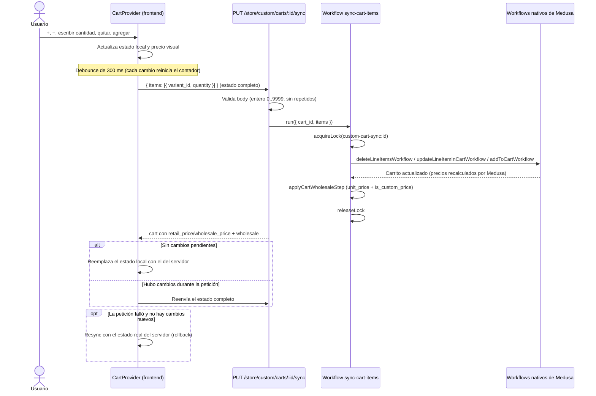

# Precio de mayoreo de punta a punta

Última actualización: 18 de octubre de 2026

| Sección | Contenido |
|---|---|
| [1. La regla](#1-la-regla) | Umbral global de pares |
| [2. Modelo de datos](#2-modelo-de-datos) | Cómo se guarda cada precio |
| [3. Constantes compartidas](#3-constantes-compartidas) | Dónde vive el 15 |
| [4. Flujo del carrito](#4-flujo-del-carrito) | Clic → estado local → endpoint → workflow |
| [5. Por qué is_custom_price](#5-por-qué-is_custom_price) | Decisión de diseño |
| [6. Widget de admin](#6-widget-de-admin) | Editar precio normal y de mayoreo, por variante o a todas |
| [7. Script seed-mayoreo.ts](#7-script-seed-mayoreots) | Carga masiva |
| [8. ADVERTENCIAS](#8-advertencias) | Lo que no hay que hacer |

---

## 1. La regla

- Se suman los pares de **todas** las líneas del carrito (umbral global, no
  por producto).
- Si el total llega a `WHOLESALE_THRESHOLD` (15), **cada línea** usa su
  precio de mayoreo. Si no, cada línea usa su precio normal.
- Una línea sin precio de mayoreo conocido usa su precio normal aunque se
  alcance el umbral.

Código: `planCartWholesale` y `resolveLinePrices` en
`backend/apps/backend/src/lib/cart-wholesale.ts`.

## 2. Modelo de datos

Cada variante tiene un *price set* con varios precios. El proyecto distingue:

| Precio | Moneda | Reglas | `min_quantity` | Quién lo gestiona |
|---|---|---|---|---|
| **Normal** | MXN | ninguna | `null` | Widget de admin o script (el admin nativo también, pero ver §8) |
| **Mayoreo** | MXN | ninguna | `15` (`WHOLESALE_MIN_QUANTITY`) | Widget de admin o script |
| Con reglas (p. ej. `region_id`) | cualquiera | sí | cualquiera | Admin nativo; **nunca** los tocan el widget ni el script |
| De listas de precios | cualquiera | — | — | Admin nativo; no se tocan |

Cómo elige cada línea del carrito sus precios (en la moneda del carrito):

- **Normal**: el precio sin `min_quantity` y sin reglas. Si no hay, usa
  `metadata.precio_menudeo` de la variante o del producto. Nunca un precio con
  `min_quantity`.
- **Mayoreo**: el precio con `min_quantity >= 15` (o, si no hay, uno con
  `min_quantity > 1`). Si no hay, usa `metadata.precio_mayoreo` de la variante o
  del producto; si tampoco, el menor de varios precios.

> Ojo: el precio que Medusa calcula por su cuenta (`calculated_price`, el que
> muestra el catálogo) puede ser uno con regla de región. El carrito, en
> cambio, usa el precio **sin reglas** para el menudeo. Si ambos difieren,
> el carrito mostrará el precio sin reglas.

## 3. Constantes compartidas

En `backend/apps/backend/src/lib/wholesale-pricing.ts`:

| Constante | Valor | Uso |
|---|---|---|
| `WHOLESALE_MIN_QUANTITY` | 15 | `min_quantity` del precio de mayoreo |
| `WHOLESALE_CURRENCY` | `"mxn"` | Moneda de los precios que gestionan widget y script |
| `MAX_ITEM_QUANTITY` | 9999 | Cantidad máxima por línea en `PUT .../sync` |

`WHOLESALE_THRESHOLD` (en `cart-wholesale.ts`) es igual a
`WHOLESALE_MIN_QUANTITY`. El widget no repite el 15: lo lee de la respuesta de
la API. El frontend (`frontend/lib/cartProducts.ts`) tiene sus propios valores
por defecto (umbral 15, máximo 9999) que se reemplazan con los que manda el
servidor.

Pendiente: `GET /store/custom/carts/:id/wholesale-summary` todavía tiene el
`15` escrito a mano.

## 4. Flujo del carrito

1. El usuario pulsa `+`/`−`, escribe una cantidad, quita o agrega un producto.
2. `CartProvider` (`frontend/lib/cartContex.tsx`) cambia el estado local **al
   instante**: cantidad, total de pares y precio visual (mayoreo o normal según
   el total local).
3. Tras **300 ms** sin más cambios, envía el **estado completo**
   (`[{ variant_id, quantity }]`) a `PUT /store/custom/carts/:id/sync`.
4. El workflow `sync-cart-items`:
   1. toma un lock por carrito (`custom-cart-sync:<id>`);
   2. compara con el carrito actual y llama a los workflows nativos
      (eliminar, actualizar, agregar) solo para lo que difiere;
   3. aplica el mayoreo **al final** (`applyCartWholesaleStep`);
   4. libera el lock.
5. La respuesta trae el carrito con `retail_price` y `wholesale_price` por
   línea. El frontend la usa **solo si no hubo cambios mientras tanto**; si los
   hubo, envía de nuevo el estado completo.
6. Si la petición falla y no hay cambios más nuevos, el frontend se resincroniza
   con el estado real del servidor (rollback).



**Falla a mitad del workflow**: los workflows nativos se ejecutan uno tras otro,
cada uno con su propia transacción. Si uno falla, lo que ya se aplicó **no se
revierte**. Como `PUT .../sync` es idempotente, el frontend lo corrige
reenviando el estado deseado completo (o resincronizando si no hay cambios
nuevos). El lock sí se libera al fallar (compensación de `acquireLockStep`).

## 5. Por qué is_custom_price

Verificado en `@medusajs/core-flows` 2.17.2:

- `updateLineItemInCartWorkflow` recalcula el `unit_price` de la línea que
  actualiza si `is_custom_price` es `false` (`prepareLineItemUpdateStep`).
- `refreshCartItemsWorkflow` con `force_refresh` recalcula **todas** las líneas
  sin `is_custom_price`. Lo usan `transferCartCustomerWorkflow` (cuando el
  cliente inicia sesión) y `updateCartWorkflow` al cambiar región o idioma.
- Agregar o eliminar líneas no fuerza ese recálculo para las demás líneas.

**Decisión**:

1. El mayoreo se aplica siempre **al final** del workflow, después de los
   workflows nativos.
2. Las líneas con precio de mayoreo quedan con `is_custom_price: true`, para que
   un recálculo posterior (p. ej. al iniciar sesión) no las regrese al precio
   calculado.
3. Al bajar del umbral, el sync pone el precio normal y `is_custom_price: false`,
   para que Medusa vuelva a gestionar la línea.
4. `POST .../sync-wholesale` usa el mismo paso, así que también sigue esta regla.

Consecuencia conocida: `updateCartWorkflow` **elimina** las líneas con
`is_custom_price: true` cuando cambia la región del carrito. El frontend no
cambia la región, pero conviene tenerlo en cuenta.

## 6. Widget de admin

Archivo: `backend/apps/backend/src/admin/widgets/wholesale-prices.tsx`, zona
`product.details.after` (al final del detalle de producto).

Rutas que usa (detalle en [api-endpoints.md](./api-endpoints.md#3-admin)):
`GET`/`POST /admin/products/:id/wholesale-prices` y
`POST /admin/variants/:id/wholesale-price`.

**Por variante**

- Cada fila tiene dos inputs, **Precio normal** y
  **Precio de mayoreo (15+ pares)** (el 15 lo manda la API), y un botón
  **Guardar** que envía ambos a `POST /admin/variants/:id/wholesale-price`.
- Mayoreo vacío + Guardar elimina solo el mayoreo. El precio normal no se puede
  vaciar si ya existe.
- El botón se habilita solo si algún campo cambió.
- Los errores al guardar (validación o respuesta 400 del backend) se muestran
  solo en un toast, no como texto bajo la fila.

**Aplicar a todas las variantes**

- Encima de la lista hay dos controles (input + botón): "Aplicar el mismo precio
  normal a todas las variantes" y "Aplicar el mismo precio de mayoreo a todas
  las variantes".
- Antes de enviar, abre el diálogo de confirmación del admin (`usePrompt` de
  `@medusajs/ui`) con el título "Aplicar precio a todas las variantes". La
  descripción indica el tipo de precio (normal o de mayoreo), el monto, cuántas
  variantes cambiarán de cuántas hay (las que no están bloqueadas y tienen otro
  valor) y cuántas se omitirán por duplicados. Botones **Aplicar** y
  **Cancelar**; si se cancela, no se envía nada.
- Envía una sola petición a `POST /admin/products/:id/wholesale-prices`.
- Si alguna variante queda en conflicto (p. ej. un normal nuevo menor o igual
  que su mayoreo actual), el backend **no aplica nada** y el widget muestra la
  lista de variantes con su motivo **solo** en un toast de error.

**Después de guardar**

- La pantalla se actualiza con la respuesta, sin recargar.
- Un toast indica cuántas variantes se actualizaron (o "Sin cambios").
- Las variantes **bloqueadas** (varios precios normales o varios de mayoreo) no
  se modifican ni se borra nada: aparecen en un toast de aviso con el motivo, y
  la fila muestra un aviso rojo permanente, porque indica un problema de datos
  (además de este aviso, solo sale texto rojo si falla la carga inicial de las
  variantes). Hay que dejar un solo precio de cada tipo a mano.
- Los avisos del plan (p. ej. precios MXN sin reglas con otros mínimos que se
  conservan) también se muestran en un toast.

**Diferencia con el script**: el widget y sus rutas usan
`planVariantPrices(..., { strictDuplicates: true })`, que bloquea las variantes
con mayoreo duplicado. El script no pasa esa opción y conserva su
comportamiento: deja un solo mayoreo y elimina los sobrantes.

No verificado: no se probó en el navegador (no se ejecutó build ni el admin);
`tsc --noEmit` del backend y de `src/admin` pasa sin errores.

## 7. Script seed-mayoreo.ts

Archivo: `backend/apps/backend/src/scripts/seed-mayoreo.ts`. Usa la misma
lógica que el widget (`src/lib/wholesale-pricing.ts`).

**Formato del JSON**

```json
[
  { "handle": "<HANDLE_DEL_PRODUCTO>", "precioNormal": 80, "precioMayoreo": 60 }
]
```

Validaciones: `handle` presente y sin repetir, ambos precios > 0 y
`precioMayoreo` < `precioNormal`.

**Cómo correrlo** (desde `backend/apps/backend`):

```bash
# Solo imprime lo que haría, con id, monto, min_quantity y reglas de cada precio
npx medusa exec ./src/scripts/seed-mayoreo.ts ./data/mayoreo.json dry-run

# Aplica los cambios
npx medusa exec ./src/scripts/seed-mayoreo.ts ./data/mayoreo.json
```

La CLI de Medusa rechaza opciones desconocidas como `--dry-run`, por eso el modo
de prueba es el argumento `dry-run` sin guiones (o `DRY_RUN=1`).

**Qué hace por variante**

- Deja, entre los precios MXN sin reglas, exactamente uno normal y uno de
  mayoreo (`min_quantity` 15).
- No modifica ni elimina precios con reglas ni de listas de precios.
- Si hay varios precios MXN sin reglas y sin mínimo, no toca nada: avisa y omite
  la variante.
- **Idempotente**: si la variante ya tiene esos montos, la omite ("sin
  cambios"); correrlo varias veces no duplica precios.

## 8. ADVERTENCIAS

> **No edites los precios de estas variantes con el editor de precios nativo
> del admin de Medusa.** Ese editor no tiene cantidad mínima y, al guardar,
> reescribe la lista de precios de la variante: puede borrar el precio de
> mayoreo o dejarlo sin `min_quantity` (convertido en un segundo precio
> normal). Usa el **widget "Precios de mayoreo"** o el **script
> `seed-mayoreo.ts`**.

- Si ya se editó con el admin nativo, corre el script en `dry-run` para ver el
  estado de cada precio antes de corregir.
- Una variante con dos precios MXN sin reglas y sin mínimo hace que el widget y
  el script se nieguen a guardar: hay que dejar uno a mano. Con dos precios de
  mayoreo, el widget también se niega (el script, en cambio, los fusiona).
- No cambies `WHOLESALE_MIN_QUANTITY` sin revisar los precios ya cargados: los
  existentes conservan su `min_quantity` anterior.
